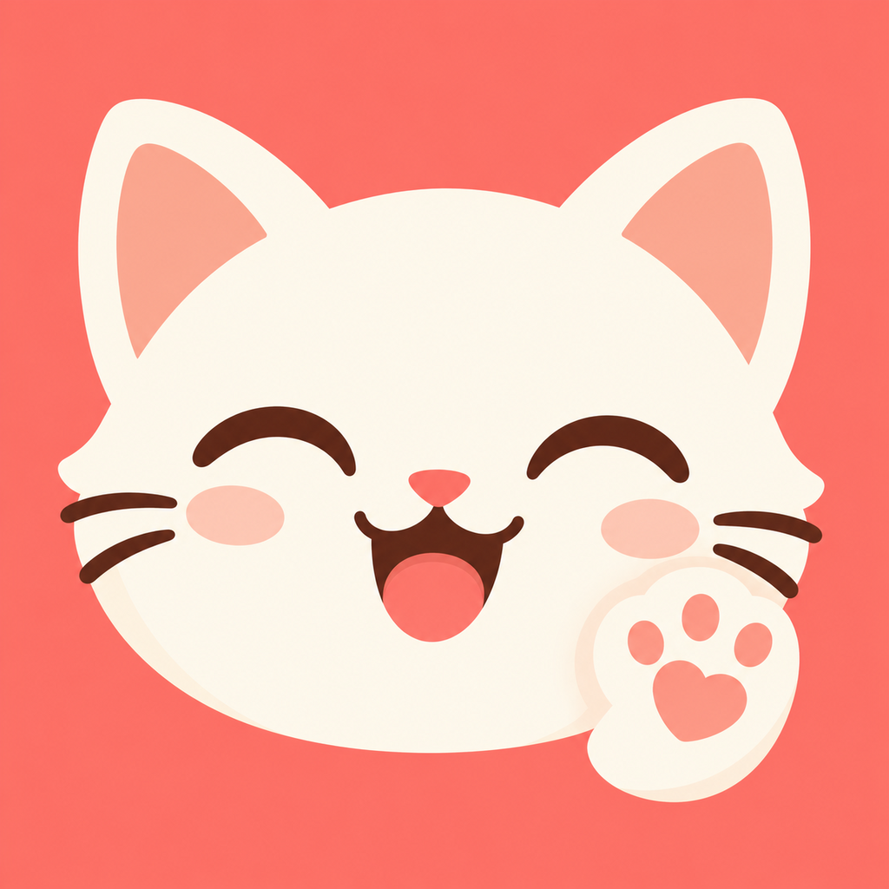

# 喵喵喵 🐾

原生 iPhone SwiftUI 猫叫娱乐 App，iOS 17+，离线运行。



- 默认 12 只猫爪，3 列 4 行；小屏适配，大字号两列滚动。
- 轻点播放，同键再点停止，换键停止前声，无循环；进入后台或音频中断停止。
- 长按编辑主人想对猫说的话，保存/取消/清空；空白不能覆盖，最多 60 字，本地保存。
- VoiceOver 全文标签、编辑操作及 Reduce Motion 支持。
- 无登录、录音、ASR、AI API、网络服务或第三方依赖。

默认文字：过来、吃饭啦、喝水啦、陪我玩、抱抱、摸摸头、我爱你、想你了、真乖、别闹啦、起床啦、晚安。
文字用于娱乐，不是猫语翻译，也不保证猫能理解或响应。

## 构建

使用已有 Xcode 打开 `MeowPaw.xcodeproj`，选择 iPhone 模拟器运行。真机运行需要自己的正常 Apple 开发签名设置。

```sh
xcodebuild test -project MeowPaw.xcodeproj -scheme MeowPaw \
  -destination 'platform=iOS Simulator,name=iPhone 16 Pro Max' \
  -derivedDataPath Build CODE_SIGNING_ALLOWED=NO
```

若模拟器名称不同，请改为本机已有 iPhone 模拟器。App 已包含全部 12 个离线 WAV；不需要下载音源才能运行。

## 音源与使用条件

12 个按钮分别来自 12 份不同原始录音，每键一个片段，无拼接重复、变调或变速：9 条 Freesound CC0 与 3 条 CatMeows 等饭场景。隔离与梳毛素材未采用。

**本仓库没有统一的开源许可。公开可见不等于所有素材可商业使用。**
三条 CatMeows 及其裁剪输出受原作者科研/非商业用途和致谢条件约束，不能按 CC0 或 MIT 音频处理。详情与完整作者致谢见 [音源说明](Research/SOURCES.md)、[CatMeows 条款](Research/CatMeows-TERMS.md)及 [权利说明](NOTICE.md)。

素材来源情境不证明猫的情绪或语义。未完成真人听审，不能承诺全部声音无人声、音乐或应激，也不能保证对特定猫有效。初始播放器相对音量 0.55，无自动循环；请结合自己的猫的反应选用。

处理与哈希见 `Research/clip-log.json`，按钮映射见 `Research/Current-Button-Mapping.md`。`prepare_audio.py` 可从所选原件/解码 WAV 重建资源；它使用带 audioop 的 Python（本项目使用系统 Python 3.9）。

## 验证范围

当前音源版在 iPhone 16 Pro Max 与 iPhone SE 3 模拟器上各通过 10 项单元及 5 项 UI 测试，覆盖 12 资源解码播放、120 次快速切换、停止/自然结束、中断、编辑持久化、大字滚动与 60 字标签布局。

真实 iPhone 16 Pro Max 已安装与运行；编辑持久化、12 键点击以及最终图标版停止/切换/实际后台停止 UI 回归通过。真机自动化用 SpringBoard 激活和后台状态前置检查，避免 Home 指令未离开前台造成错误结论。真人听感、猫反应、VoiceOver 朗读、触感和音频路线仍未验证。

仓库只包含开发所需源码、资源、来源和处理记录；私人交付包、设备资料、签名、账号信息及构建缓存不在此仓库。
